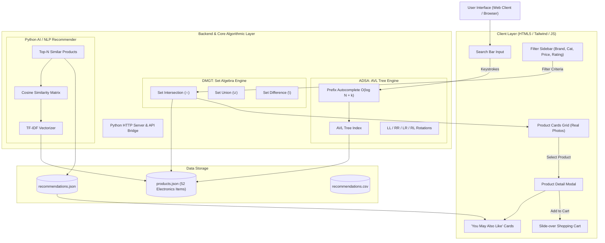
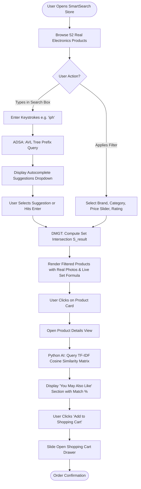
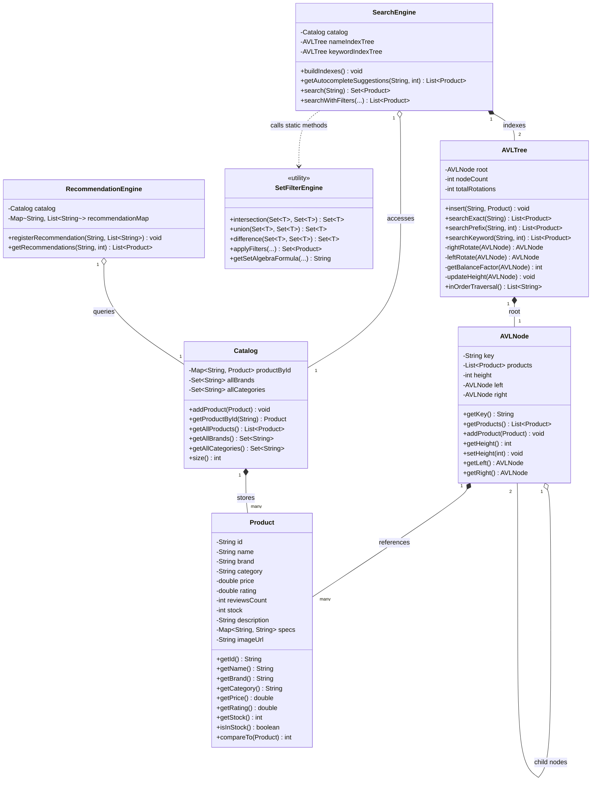
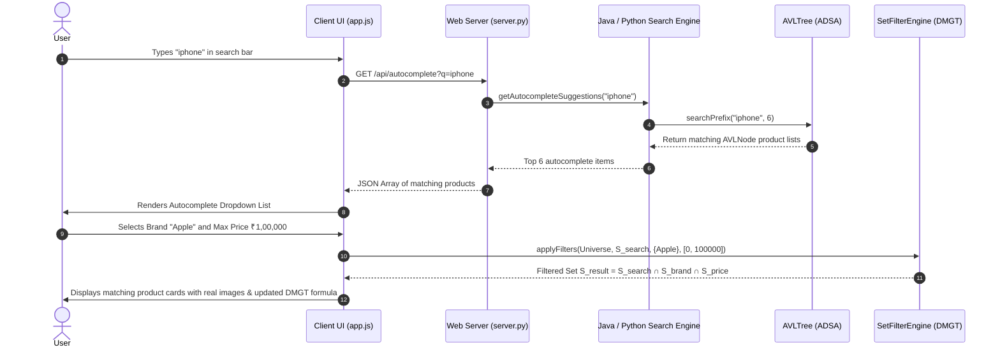

# SmartSearch: UML Diagrams & System Flowcharts

This document provides visual flowcharts and UML architectural diagrams for academic presentations, project defense, and viva evaluations.

---

## 1. System Architecture Flowchart



---

## 2. Complete User Search & Recommendation Flowchart



---

## 3. ADSA: AVL Tree Balancing & Rotations Flowchart

```mermaid
flowchart TD
    Insert[Insert New Product Key into BST] --> UpdateH[Update Height of Ancestor Node]
    UpdateH --> CalcBF["Calculate Balance Factor BF = height(Left) - height(Right)"]
    
    CalcBF --> CheckBal{Is |BF| > 1 ?}
    CheckBal -->|No: BF is -1, 0, or +1| Balanced([Node is Balanced])
    
    CheckBal -->|Yes: Imbalance Detected| CheckCase{Determine Imbalance Type}
    
    CheckCase -->|BF > 1 and Key < Left.Key| CaseLL["Left-Left (LL) Case"]
    CaseLL --> RotateRight["Perform Single Right Rotation"]
    
    CheckCase -->|BF < -1 and Key > Right.Key| CaseRR["Right-Right (RR) Case"]
    CaseRR --> RotateLeft["Perform Single Left Rotation"]
    
    CheckCase -->|BF > 1 and Key > Left.Key| CaseLR["Left-Right (LR) Case"]
    CaseLR --> RotateLR["Rotate Left on Left Child, then Rotate Right on Node"]
    
    CheckCase -->|BF < -1 and Key < Right.Key| CaseRL["Right-Left (RL) Case"]
    CaseRL --> RotateRL["Rotate Right on Right Child, then Rotate Left on Node"]
    
    RotateRight --> Balanced
    RotateLeft --> Balanced
    RotateLR --> Balanced
    RotateRL --> Balanced
```

---

## 4. UML Class Diagram (Java OOPJ & ADSA & DMGT)



---

## 5. Sequence Diagram: Autocomplete & Search Execution


